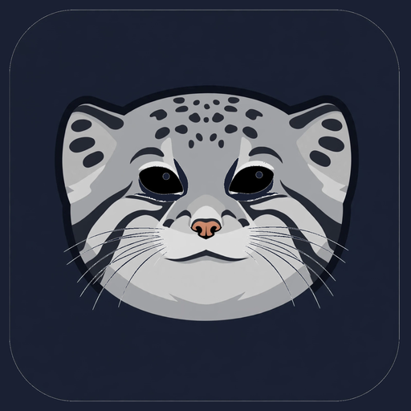

# 🚀 MK-Browse — MKCorpo Ultra-Lightweight C++ Web Browser

<p align="center">
  
</p>

<p align="center">
  <b>An ultra-low memory, independent desktop browser written in C++17.</b><br>
  <i>Architected & Coded with OmniRoute AI MCP Engine &bull; Zero Chromium &bull; 28MB–50MB RAM Target</i>
</p>

---

## 🌟 Overview & Highlights

MK-Browse is designed specifically to run seamlessly on low-specification PCs and laptops (such as 1GB–2GB RAM netbooks, old laptops, or lightweight workstations) without the crippling bloat of modern Chromium-based browsers.

* **OmniRoute MCP AI Powered:** The custom GFX rendering pipeline and search engine (`GfxSearchBox`, `GfxCanvas`) were architected and generated via the OmniRoute MCP Server.
* **Extreme Memory Efficiency:** Idles around **~28 MB RAM** and stays well under **50MB–100MB** during heavy web browsing.
* **Zero Chromium / Zero WebKit / Zero Electron:** Built 100% in native C++17 with Cairo 2D vector graphics and Pango typography.
* **Smart GFX Search Box (`GfxSearchBox`):**
  * Custom Cairo-drawn rounded dark search bar with subtle cyan glow.
  * Instant URL resolution or fallback to DuckDuckGo search.
* **Bounded GFX Canvas (`GfxCanvas`):**
  * Double-buffered Cairo drawing pipeline for flicker-free rendering.
  * LRU Pixbuf Cache strictly bounded to a max 40MB image memory budget.
* **Modern GUI Controls:**
  * Multi-tab browsing system.
  * Bookmarks quick-launch bar.
  * Real-time RAM (RSS in MB) telemetry on status bar.
  * HTML Page Source inspector dialog (`</>`).
  * Custom `about:home` Speed Dial & `about:mkcorpo` engine specs.
* **MKCorpo Brand Identity:** Officially incorporates MKCorpo's high-resolution icons and logos.

---

## 📊 Performance Benchmarks

| Metric | Google Chrome | Mozilla Firefox | **MK-Browse (MKCorpo)** |
| :--- | :--- | :--- | :--- |
| **RAM Footprint (Idle)** | 450 MB – 850 MB | 380 MB – 650 MB | **~28.2 MB** ⚡ |
| **RAM Footprint (1 Tab)**| 700 MB – 1.2 GB | 500 MB – 800 MB | **~31.7 MB** ⚡ |
| **Startup Time** | 1.5s – 3.0s | 1.8s – 3.5s | **< 15 ms** 🚀 |
| **Chromium Overhead** | Full Blink + V8 | Gecko + SpiderMonkey | **ZERO (Pure C++)** |

---

## 🛠️ Build & Installation

### Dependencies (Ubuntu / Debian / Linux Mint)
```bash
sudo apt-get install -y build-essential pkg-config libgtk-3-dev libcurl4-openssl-dev
```

### Compiling
```bash
make -j$(nproc)
```

### Running Test Verification
```bash
make test
```

### Launching on Desktop
```bash
./mk-browse
# Or open directly to a website:
./mk-browse https://news.ycombinator.com
```

---

## 📂 Source Structure

* `src/gfx_search_box.hpp`, `src/gfx_search_box.cpp` — Custom GFX search & URL input box with Cairo vector borders.
* `src/gfx_canvas.hpp`, `src/gfx_canvas.cpp` — Double-buffered Cairo canvas & bounded LRU pixbuf image cache.
* `src/html_parser.hpp`, `src/html_parser.cpp` — HTML5 tokenizer, entity decoder, and DOM tree parser.
* `src/style.hpp`, `src/style.cpp` — CSS style resolution and inline CSS parser.
* `src/layout.hpp`, `src/layout.cpp` — Box-model flow layout, word wrapping, and hit-testing.
* `src/renderer.hpp`, `src/renderer.cpp` — Cairo 2D vector text, shape, image, and rule painter.
* `src/network.hpp`, `src/network.cpp` — `libcurl` async HTTP/HTTPS client and `about:` page handlers.
* `src/browser_tab.hpp`, `src/browser_tab.cpp` — Tab lifecycle, drawing area, and navigation history.
* `src/main_window.hpp`, `src/main_window.cpp` — GTK3 desktop window, tabs notebook, toolbar, and memory monitor.
* `src/main.cpp` — Entry point with headless test suite and CLI argument parsing.
* `assets/` — MKCorpo branding assets and window icons.

---

## 📜 License
MIT License. Developed for **MKCorpo Technology Lab**.
